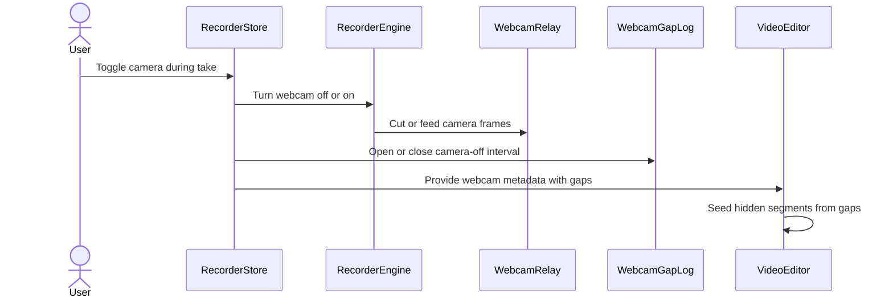

=== ISSUE_COMMENT 2026-11-01T20:56:38Z
<!-- coderabbit-ai-generated:v1 -->

<!-- This is an auto-generated comment: summarize by coderabbit.ai -->
<!-- review_stack_entry_start -->

<a href="https://app.coderabbit.ai/change-stack/niway-dev/kaipu-bench-coderabbit/pull/1?scope=ghh_OusAJGA4HG8ljoOV0wJvVx8NmnZIjc2DdjmxOu0xZWA&amp;cs_source=review_comment"><picture><source media="(prefers-color-scheme: dark)" srcset="https://storage.googleapis.com/coderabbit_public_assets/review-stack-in-coderabbit-ui-dark.svg?v=3"><source media="(prefers-color-scheme: light)" srcset="https://storage.googleapis.com/coderabbit_public_assets/review-stack-in-coderabbit-ui.svg?v=3"></picture></a>

<!-- review_stack_entry_end -->
<!-- configuration_strict_warnings_start -->

> [!NOTE]
> ### `.coderabbit.yaml` has unrecognized properties
> 
> CodeRabbit is using all valid settings from your configuration. Unrecognized properties (listed below) have been ignored and may indicate typos or deprecated fields that can be removed.
> 
> <details>
> <summary><strong><picture></picture> Parsing warnings: 1</strong></summary>
> <dl>
> <dd>
> 
> ```
> Validation error: Unrecognized key: "allow_apply_suggestions"
> ```
> 
> </dd>
> </dl>
> </details>
> 
> <details>
> <summary><strong><picture><source media="(prefers-color-scheme: dark)" srcset="https://storage.googleapis.com/coderabbit_public_assets/review-comment-icons-v1/cog-dark.svg"></picture> Configuration instructions</strong></summary>
> <dl>
> <dd>
> 
> - Please see the [configuration documentation](https://docs.coderabbit.ai/guides/configure-coderabbit) for more information.
> - You can also validate your configuration using the [online YAML validator](https://docs.coderabbit.ai/configuration/yaml-validator).
> - If your editor has YAML language server enabled, you can add the path at the top of this file to enable auto-completion and validation: `# yaml-language-server: $schema=https://coderabbit.ai/integrations/schema.v2.json`
> 
> </dd>
> </dl>
> </details>

<!-- configuration_strict_warnings_end -->
<!-- recent_review_start -->

No actionable comments were generated in the recent review.

<details>
<summary><strong><picture></picture> Recent review info</strong></summary>
<dl>
<dd>

<!-- review_info_content -->
<details>
<summary><strong><picture><source media="(prefers-color-scheme: dark)" srcset="https://storage.googleapis.com/coderabbit_public_assets/review-comment-icons-v1/cog-dark.svg"></picture> Run configuration</strong></summary>
<dl>
<dd>

- **Source mode**: Auto
- **Repository**: [niway-dev/kaipu-bench-coderabbit](<https://github.com/niway-dev/kaipu-bench-coderabbit>)
- **Branch**: [replay/pr-463/head](<https://github.com/niway-dev/kaipu-bench-coderabbit/tree/replay%2Fpr-463%2Fhead>)
- **File**: [.coderabbit.yaml](<https://github.com/niway-dev/kaipu-bench-coderabbit/blob/3ec7a138c3a878b38284fd13c801ab7226a34abb/.coderabbit.yaml>)
- **Commit**: [3ec7a13](<https://github.com/niway-dev/kaipu-bench-coderabbit/commit/3ec7a138c3a878b38284fd13c801ab7226a34abb>)
- **Layers**: Repository YAML
- **Review profile**: CHILL
- **Plan**: Advanced
- **Run ID**: `d811c6dd-5026-44e5-8863-c5965ce25e2a`

</dd>
</dl>
</details>

<details>
<summary><strong><picture><source media="(prefers-color-scheme: dark)" srcset="https://storage.googleapis.com/coderabbit_public_assets/review-comment-icons-v1/git-commit-horizontal-dark.svg"></picture> Commits</strong></summary>
<dl>
<dd>

Reviewing files that changed from the base of the PR and between c58b68f437293377f0188e6c460ad782a313dbb1 and 3ec7a138c3a878b38284fd13c801ab7226a34abb.

</dd>
</dl>
</details>

<details>
<summary><strong><picture><source media="(prefers-color-scheme: dark)" srcset="https://storage.googleapis.com/coderabbit_public_assets/review-comment-icons-v1/file-minus-corner-dark.svg"></picture> Files ignored due to path filters: 2</strong></summary>
<dl>
<dd>

* `apps/documentation/src/content/docs/architecture/decisions/0032-webcam-is-its-own-track-and-the-bubble-is-excluded-from-capture.mdx` is excluded by `!**/*.mdx` and included by `**/*`
* `apps/documentation/src/content/docs/specs/2026-10-30-webcam-track-design.md` is excluded by `!**/*.md` and included by `**/*`

</dd>
</dl>
</details>

<details>
<summary><strong><picture><source media="(prefers-color-scheme: dark)" srcset="https://storage.googleapis.com/coderabbit_public_assets/review-comment-icons-v1/file-plus-corner-dark.svg"></picture> Files selected for processing: 21</strong></summary>
<dl>
<dd>

* `apps/kaipu-record/src/main/recording/bubble-protection.test.ts`
* `apps/kaipu-record/src/main/recording/bubble-protection.ts`
* `apps/kaipu-record/src/main/recording/camera-bubble-window.test.ts`
* `apps/kaipu-record/src/main/recording/camera-bubble-window.ts`
* `apps/kaipu-record/src/main/recording/recording-hub.test.ts`
* `apps/kaipu-record/src/main/recording/recording-hub.ts`
* `apps/kaipu-record/src/renderer/src/features/camera-bubble/camera-bubble.test.tsx`
* `apps/kaipu-record/src/renderer/src/features/camera-bubble/camera-bubble.tsx`
* `apps/kaipu-record/src/renderer/src/features/recording/recorder-engine.test.tsx`
* `apps/kaipu-record/src/renderer/src/features/recording/recorder-engine.ts`
* `apps/kaipu-record/src/renderer/src/features/recording/recorder-store.test.ts`
* `apps/kaipu-record/src/renderer/src/features/recording/recorder-store.ts`
* `apps/kaipu-record/src/renderer/src/features/recording/webcam-gaps.test.ts`
* `apps/kaipu-record/src/renderer/src/features/recording/webcam-gaps.ts`
* `apps/kaipu-record/src/renderer/src/features/recording/webcam-relay.test.ts`
* `apps/kaipu-record/src/renderer/src/features/recording/webcam-relay.ts`
* `apps/kaipu-record/src/renderer/src/features/video-editor/scene.ts`
* `apps/kaipu-record/src/renderer/src/features/video-editor/webcam/webcam-model.test.ts`
* `apps/kaipu-record/src/renderer/src/features/video-editor/webcam/webcam-model.ts`
* `apps/kaipu-record/src/shared/webcam-track.test.ts`
* `apps/kaipu-record/src/shared/webcam-track.ts`

</dd>
</dl>
</details>

**Included review availability:** This review used your included allowance. Your plan provides up to 10 included reviews per hour; 9 remain after this review.

</dd>
</dl>
</details>


<!-- recent_review_end -->
<!-- walkthrough_start -->

<details>
<summary><strong>Walkthrough</strong></summary>
<dl>
<dd>

The change adds camera toggles during webcam recording, preserves the webcam output through camera switches when relay support is available, records camera-off intervals in webcam metadata, and seeds hidden webcam segments from those intervals in the video editor.

**Changes: Webcam Toggle and Gap Handling**

|Layer / File(s)|Summary|
|:---|:---|
|**Persistent webcam relay and engine controls** <br> `apps/kaipu-record/src/renderer/src/features/recording/webcam-relay.ts`, `webcam-relay.test.ts`, `recorder-engine.ts`, `recorder-engine.test.tsx`|A relay supplies a persistent encoder track across camera switches. Engine handles expose controls to turn the camera off and reopen it. Tests cover frame forwarding, reopen behavior, failure cases, and cleanup.|
|**Bubble window lifecycle during camera toggles** <br> `apps/kaipu-record/src/main/recording/bubble-protection.ts`, `bubble-protection.test.ts`, `camera-bubble-window.ts`, `camera-bubble-window.test.ts`, `recording-hub.ts`, `recording-hub.test.ts`|The recording hub parks the protected bubble during a take that records webcam output. It reuses the parked window when the camera returns and releases it when required by recording state.|
|**Camera preview follows recording settings** <br> `apps/kaipu-record/src/renderer/src/features/camera-bubble/camera-bubble.tsx`, `camera-bubble.test.tsx`|The camera preview follows recording-setting broadcasts and uses the initial setting only if no broadcast arrives first.|
|**Capture and sanitize camera-off intervals** <br> `apps/kaipu-record/src/renderer/src/features/recording/recorder-store.ts`, `recorder-store.test.ts`, `webcam-gaps.ts`, `webcam-gaps.test.ts`, `apps/kaipu-record/src/shared/webcam-track.ts`, `webcam-track.test.ts`|The recorder tracks camera-off intervals and adds nonempty gaps to webcam metadata. Metadata sanitization sorts and merges intervals and limits the result to 1,000 gaps.|
|**Seed hidden editor segments from gaps** <br> `apps/kaipu-record/src/renderer/src/features/video-editor/scene.ts`, `apps/kaipu-record/src/renderer/src/features/video-editor/webcam/webcam-model.ts`, `webcam-model.test.ts`|The initial scene supplies the recording duration. The webcam model converts recorded gaps into hidden segments, merges overlaps, and bounds segments by the known duration.|

<!-- change_assessment_start -->
**Estimated code review effort:** 4 (Complex) | ~45 minutes

<!-- change_assessment_commit:"3ec7a138c3a878b38284fd13c801ab7226a34abb" -->
<!-- change_assessment_priority:{"version":1,"urgency":"p2","manual":false} -->
**Change:** Bug fix
<!-- change_assessment_end -->

### Sequence Diagram(s)



</dd>
</dl>
</details>

<!-- walkthrough_end -->
<details>
<summary><strong>Merge Risk:</strong> <strong><picture></picture> Minimal</strong> · up to <code>3ec7a</code></summary>
<dl>
<dd>

<!-- final_review_risk_start -->
<!-- final_review_risk_label
**Merge Risk:** **⚪ Minimal** · up to `3ec7a`
-->
<!-- final_review_risk_coverage:{"sourceCommitId":"3ec7a138c3a878b38284fd13c801ab7226a34abb","coveredCommitId":"3ec7a138c3a878b38284fd13c801ab7226a34abb","kind":"reviewed"} -->

No confirmed issue currently blocks merging. Validate camera toggling in the packaged app as part of normal release checks.
<!-- final_review_risk_end -->

</dd>
</dl>
</details>

<details>
<summary><strong>Security architecture risk:</strong> <strong><picture></picture> Moderate</strong> · up to <code>3ec7a</code></summary>
<dl>
<dd>

<!-- architecture_review_start -->
<!-- architecture_review_label
### Security Architecture Review

**Security architecture risk:** **🟡 Moderate** · up to `3ec7a`
-->

A queued camera-on action can run after a later camera-off action, reopening and recording the camera while its toggle remains off. The exposure is limited to the current desktop recording, but hiding the resulting footage during editing does not prevent its capture or local storage.

**Retained concerns**
- **Medium · security · inferred:** A stale queued reopen can override a newer camera-off choice. During an active relay-backed take, camera off stops input immediately, whereas camera on is appended to the shared audio/settings queue. If another off arrives before that queued on starts, it invalidates only requests already started. When the stale task eventually runs, turnWebcamOn establishes a fresh request and reopens the device without checking the latest setting. This can capture and write live camera frames while the toggle remains off. The open gap hides those frames in the default editor scene, but does not prevent acquisition or retention in the raw webcam file. This reopening path is new relative to the base’s terminal-off behavior.

<details>
<summary><strong>Security review details</strong></summary>
<dl>
<dd>

**Security Blast Radius**
- _inferred_ — The demonstrated privacy path concerns the active desktop take’s camera and local webcam file, with camera access already authorized. Webcam chunks remain guarded by take identity. The evidence does not establish a remote invocation path or exposure across users or services.

**Security Findings and Attack Paths**
- _inferred_ — An off/on/off sequence while earlier audio work delays the settings queue can leave the final off setting intact but execute the stale on afterward. The resulting camera frames can reach the persistent webcam output. Keeping the gap open masks default presentation, not capture or raw-file retention.

**Trust Boundaries and Controls**
- _observed_ — Native window lifecycle remains controlled by the main-process recording hub. Renderer settings select parking or destruction through the hub, while webcam ownership determines the protection policy. The PR changes lifecycle behavior rather than introducing a new native-control IPC authority.

**Resilience and Maintainability Implications**
- _observed_ — The engine rejects and stops camera streams superseded while opening, and normal stop releases the reopened camera and relay in final cleanup. Existing race tests start reopening before issuing the newer off action, so they do not establish cancellation of an on action still waiting in the settings queue.

**Hardening Proposals**
- _proposed_ — Bind queued reopen work to a camera-intent generation captured when settings change. Revalidate that generation, the desired camera state, and take liveness before acquiring or feeding a camera; invalidate pending work on camera off and terminal transitions.

</dd>
</dl>
</details>
<!-- architecture_review_end -->

</dd>
</dl>
</details>
<!-- pre_merge_checks_walkthrough_start -->

<details>
<summary><strong>Pre-merge checks: <sup><picture></picture></sup> 5</strong></summary>
<dl>
<dd>

|         Check name         |                                             Status                                             | Explanation                                                                                                                                                                                               |
| :------------------------ | :--------------------------------------------------------------------------------------------: | :-------------------------------------------------------------------------------------------------------------------------------------------------------------------------------------------------------- |
|      Description Check     |  | Check skipped - CodeRabbit’s high-level summary is enabled.                                                                                                                                               |
|         Title check        |  | The title names the main behavior change: turning the camera off and on during a take keeps the webcam recording in its own track. The raw summary confirms this change: the bubble is parked, camera-of… |
|     Docstring Coverage     |  | Docstring coverage is 82.35% which is sufficient. The required threshold is 80.00%. Docstring coverage is scoped to functions touched by this diff with cyclomatic complexity of at least 2. Documentati… |
|     Linked Issues check    |  | Check skipped because no linked issues were found for this pull request.                                                                                                                                  |
| Out of Scope Changes check |  | Check skipped because no linked issues were found for this pull request.                                                                                                                                  |

<details>
<summary><strong>Full details: Title check</strong></summary>
<dl>
<dd>

**Explanation**

The title names the main behavior change: turning the camera off and on during a take keeps the webcam recording in its own track. The raw summary confirms this change: the bubble is parked, camera-off intervals are recorded as webcam gaps, and the relay keeps one webcam file open. The '[replay]' prefix and the 'fix(desktop)' scope are noise, but the title still describes a real, central part of the changeset. It is not vague and it is not off-topic.

</dd>
</dl>
</details>

<details>
<summary><strong>Full details: Docstring Coverage</strong></summary>
<dl>
<dd>

**Explanation**

Docstring coverage is 82.35% which is sufficient. The required threshold is 80.00%. Docstring coverage is scoped to functions touched by this diff with cyclomatic complexity of at least 2. Documentation-only edits and deletions within surviving functions are included; unchanged diff context and fully deleted functions are excluded. Analyzed 17 functions across 21 files.

</dd>
</dl>
</details>

</dd>
</dl>
</details>

<!-- pre_merge_checks_walkthrough_end -->
<!-- finishing_touch_checkbox_start -->

<details>
<summary><strong>Finishing Touches</strong></summary>
<dl>
<dd>

<details open>
<summary><strong>Generate docstrings</strong></summary>
<dl>
<dd>

- [ ] <!-- {"checkboxId":"3e1879ae-f29b-4d0d-8e06-d12b7ba33d98"} --> Commit to this branch
- [ ] <!-- {"checkboxId":"7962f53c-55bc-4827-bfbf-6a18da830691"} --> Create a new PR

</dd>
</dl>
</details>
<details open>
<summary><strong>Generate unit tests (beta)</strong></summary>
<dl>
<dd>

- [ ] <!-- {"checkboxId": "6ba7b810-9dad-11d1-80b4-00c04fd430c8", "radioGroupId": "utg-output-choice-group-6563901872"} --> Commit to this branch
- [ ] <!-- {"checkboxId": "f47ac10b-58cc-4372-a567-0e02b2c3d479", "radioGroupId": "utg-output-choice-group-6563901872"} --> Create a new PR

</dd>
</dl>
</details>

</dd>
</dl>
</details>

<!-- finishing_touch_checkbox_end -->

<!-- autopilot:start -->
- [ ] <!-- {"checkboxId":"2708ad07-9f24-4260-9c11-7dc76a49f2e3"} --> <strong title="Keep fixing CodeRabbit findings and required CI, and resolving merge conflicts">Autofix</strong> · Keep fixing CodeRabbit findings and required CI, and resolving merge conflicts
<!-- autopilot:end -->

=== ISSUE_COMMENT 2026-11-01T21:08:09Z
<!-- coderabbit-ai-generated:v1 -->

<!-- This is an auto-generated reply by CodeRabbit -->
<!-- CodeRabbit review command invocation: v2:69813321e5ded1bcce41b6dbe86f4ba1f537d4867db958dd24e37a63c564f984 -->
<details>
<summary>Action performed</summary>
<dl>
<dd>

Review finished.

> Note: CodeRabbit is an incremental review system and does not re-review already reviewed commits. This command is applicable only when automatic reviews are paused.

</dd>
</dl>
</details>

