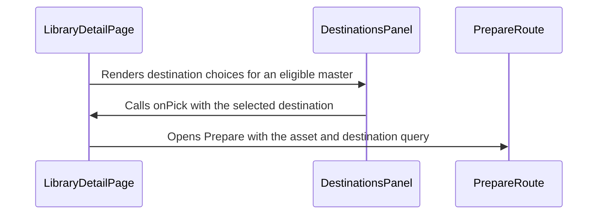

=== ISSUE_COMMENT 2026-11-01T20:56:50Z
<!-- coderabbit-ai-generated:v1 -->

<!-- This is an auto-generated comment: summarize by coderabbit.ai -->
<!-- review_stack_entry_start -->

<a href="https://app.coderabbit.ai/change-stack/niway-dev/kaipu-bench-coderabbit/pull/3?scope=ghh_OusAJGA4HG8ljoOV0wJvVx8NmnZIjc2DdjmxOu0xZWA&amp;cs_source=review_comment"><picture><source media="(prefers-color-scheme: dark)" srcset="https://storage.googleapis.com/coderabbit_public_assets/review-stack-in-coderabbit-ui-dark.svg?v=3"><source media="(prefers-color-scheme: light)" srcset="https://storage.googleapis.com/coderabbit_public_assets/review-stack-in-coderabbit-ui.svg?v=3"></picture></a>

<!-- review_stack_entry_end -->
<!-- configuration_strict_warnings_start -->

> [!NOTE]
> ### `.coderabbit.yaml` has unrecognized properties
> 
> CodeRabbit is using all valid settings from your configuration. Unrecognized properties (listed below) have been ignored and may indicate typos or deprecated fields that can be removed.
> 
> <details>
> <summary><strong><picture></picture> Parsing warnings: 1</strong></summary>
> <dl>
> <dd>
> 
> ```
> Validation error: Unrecognized key: "allow_apply_suggestions"
> ```
> 
> </dd>
> </dl>
> </details>
> 
> <details>
> <summary><strong><picture><source media="(prefers-color-scheme: dark)" srcset="https://storage.googleapis.com/coderabbit_public_assets/review-comment-icons-v1/cog-dark.svg"></picture> Configuration instructions</strong></summary>
> <dl>
> <dd>
> 
> - Please see the [configuration documentation](https://docs.coderabbit.ai/guides/configure-coderabbit) for more information.
> - You can also validate your configuration using the [online YAML validator](https://docs.coderabbit.ai/configuration/yaml-validator).
> - If your editor has YAML language server enabled, you can add the path at the top of this file to enable auto-completion and validation: `# yaml-language-server: $schema=https://coderabbit.ai/integrations/schema.v2.json`
> 
> </dd>
> </dl>
> </details>

<!-- configuration_strict_warnings_end -->
<!-- recent_review_start -->

No actionable comments were generated in the recent review.

<details>
<summary><strong><picture></picture> Recent review info</strong></summary>
<dl>
<dd>

<!-- review_info_content -->
<details>
<summary><strong><picture><source media="(prefers-color-scheme: dark)" srcset="https://storage.googleapis.com/coderabbit_public_assets/review-comment-icons-v1/cog-dark.svg"></picture> Run configuration</strong></summary>
<dl>
<dd>

- **Source mode**: Auto
- **Repository**: [niway-dev/kaipu-bench-coderabbit](<https://github.com/niway-dev/kaipu-bench-coderabbit>)
- **Branch**: [replay/pr-465/head](<https://github.com/niway-dev/kaipu-bench-coderabbit/tree/replay%2Fpr-465%2Fhead>)
- **File**: [.coderabbit.yaml](<https://github.com/niway-dev/kaipu-bench-coderabbit/blob/dac8318b631e64780f65ce94b4aaa57261d7d63d/.coderabbit.yaml>)
- **Commit**: [dac8318](<https://github.com/niway-dev/kaipu-bench-coderabbit/commit/dac8318b631e64780f65ce94b4aaa57261d7d63d>)
- **Layers**: Repository YAML
- **Review profile**: CHILL
- **Plan**: Advanced
- **Run ID**: `94448a4a-d945-4b32-ab3f-1644b00e5627`

</dd>
</dl>
</details>

<details>
<summary><strong><picture><source media="(prefers-color-scheme: dark)" srcset="https://storage.googleapis.com/coderabbit_public_assets/review-comment-icons-v1/git-commit-horizontal-dark.svg"></picture> Commits</strong></summary>
<dl>
<dd>

Reviewing files that changed from the base of the PR and between 13b7ff5da65f3d0b59d0542132babf328ce373b3 and dac8318b631e64780f65ce94b4aaa57261d7d63d.

</dd>
</dl>
</details>

<details>
<summary><strong><picture><source media="(prefers-color-scheme: dark)" srcset="https://storage.googleapis.com/coderabbit_public_assets/review-comment-icons-v1/file-minus-corner-dark.svg"></picture> Files ignored due to path filters: 2</strong></summary>
<dl>
<dd>

* `apps/documentation/src/content/docs/backlog/index.mdx` is excluded by `!**/*.mdx` and included by `**/*`
* `apps/documentation/src/content/docs/backlog/prepare-screen.md` is excluded by `!**/*.md` and included by `**/*`

</dd>
</dl>
</details>

<details>
<summary><strong><picture><source media="(prefers-color-scheme: dark)" srcset="https://storage.googleapis.com/coderabbit_public_assets/review-comment-icons-v1/file-plus-corner-dark.svg"></picture> Files selected for processing: 12</strong></summary>
<dl>
<dd>

* `apps/kaipu-record/src/renderer/src/features/prepare/components/destinations-panel.module.css`
* `apps/kaipu-record/src/renderer/src/features/prepare/components/destinations-panel.tsx`
* `apps/kaipu-record/src/renderer/src/features/prepare/components/master-copies-panel.module.css`
* `apps/kaipu-record/src/renderer/src/features/prepare/components/master-copies-panel.test.tsx`
* `apps/kaipu-record/src/renderer/src/features/prepare/components/master-copies-panel.tsx`
* `apps/kaipu-record/src/renderer/src/features/prepare/components/where-is-this-going-strip.module.css`
* `apps/kaipu-record/src/renderer/src/features/prepare/components/where-is-this-going-strip.tsx`
* `apps/kaipu-record/src/renderer/src/pages/library-detail/library-detail-page.module.css`
* `apps/kaipu-record/src/renderer/src/pages/library-detail/library-detail-page.test.tsx`
* `apps/kaipu-record/src/renderer/src/pages/library-detail/library-detail-page.tsx`
* `packages/i18n/messages/en.json`
* `packages/i18n/messages/es.json`

</dd>
</dl>
</details>

<details>
<summary><strong><picture><source media="(prefers-color-scheme: dark)" srcset="https://storage.googleapis.com/coderabbit_public_assets/review-comment-icons-v1/file-no-changes-dark.svg"></picture> Files with no reviewable changes: 2</strong></summary>
<dl>
<dd>

* apps/kaipu-record/src/renderer/src/features/prepare/components/where-is-this-going-strip.module.css
* apps/kaipu-record/src/renderer/src/features/prepare/components/where-is-this-going-strip.tsx

</dd>
</dl>
</details>

**Included review availability:** This review used your included allowance. Your plan provides up to 10 included reviews per hour; 7 remain after this review.

</dd>
</dl>
</details>


<!-- recent_review_end -->
<!-- walkthrough_start -->

<details>
<summary><strong>Walkthrough</strong></summary>
<dl>
<dd>

The library detail page replaces the destination strip with destination cards for eligible masters. It updates copy listings with dimensions, sizes, progress, and drag controls. It also adds a dismissible saved notice and updates detail-page metadata and layout.

**Changes: Library copy and export**

|Layer / File(s)|Summary|
|:---|:---|
|**Destination selection panel** <br> `apps/kaipu-record/src/renderer/src/features/prepare/components/destinations-panel.tsx`, `apps/kaipu-record/src/renderer/src/features/prepare/components/destinations-panel.module.css`, `apps/kaipu-record/src/renderer/src/features/prepare/components/where-is-this-going-strip.tsx`, `apps/kaipu-record/src/renderer/src/features/prepare/components/where-is-this-going-strip.module.css`|Adds destination cards with estimated sizes, selection and dismissal callbacks, and optional guidance. Removes the previous destination strip.|
|**Copy details and controls** <br> `apps/kaipu-record/src/renderer/src/features/prepare/components/master-copies-panel.tsx`, `apps/kaipu-record/src/renderer/src/features/prepare/components/master-copies-panel.module.css`, `apps/kaipu-record/src/renderer/src/features/prepare/components/master-copies-panel.test.tsx`, `packages/i18n/messages/en.json`, `packages/i18n/messages/es.json`|Shows copy dimensions and file sizes, export progress, and available drag and export controls. Updates associated translations and tests.|
|**Detail page workflow and layout** <br> `apps/kaipu-record/src/renderer/src/pages/library-detail/library-detail-page.tsx`, `apps/kaipu-record/src/renderer/src/pages/library-detail/library-detail-page.module.css`, `apps/kaipu-record/src/renderer/src/pages/library-detail/library-detail-page.test.tsx`|Controls destination-panel and copy-list visibility, routes export actions, and displays metadata and a dismissible saved notice. Updates the page layout and related tests.|

<!-- change_assessment_start -->
**Estimated code review effort:** 3 (Moderate) | ~25 minutes

<!-- change_assessment_commit:"dac8318b631e64780f65ce94b4aaa57261d7d63d" -->
<!-- change_assessment_priority:{"version":1,"urgency":"p2","manual":false} -->
**Change:** Feature
<!-- change_assessment_end -->

### Sequence Diagram(s)



</dd>
</dl>
</details>

<!-- walkthrough_end -->
<details>
<summary><strong>Merge Risk:</strong> <strong><picture></picture> Minimal</strong> · up to <code>dac83</code></summary>
<dl>
<dd>

<!-- final_review_risk_start -->
<!-- final_review_risk_label
**Merge Risk:** **⚪ Minimal** · up to `dac83`
-->
<!-- final_review_risk_coverage:{"sourceCommitId":"dac8318b631e64780f65ce94b4aaa57261d7d63d","coveredCommitId":"dac8318b631e64780f65ce94b4aaa57261d7d63d","kind":"reviewed"} -->

The copy and export flow is mergeable after normal checks. In a narrow navigation case, a previously dismissed destination panel may remain hidden on return, but export remains available.
<!-- final_review_risk_end -->

</dd>
</dl>
</details>

<details>
<summary><strong>Security architecture risk:</strong> <strong><picture></picture> Low</strong> · up to <code>dac83</code></summary>
<dl>
<dd>

<!-- architecture_review_start -->
<!-- architecture_review_label
### Security Architecture Review

**Security architecture risk:** **🔵 Low** · up to `dac83`
-->

The new export and drag controls reuse existing file-access capabilities. No security regression was established, but authorization and filesystem-containment guarantees remain only partially demonstrated.

**Retained concerns**
No architecture-level concerns identified.

<details>
<summary><strong>Security review details</strong></summary>
<dl>
<dd>

**Security Blast Radius**
- _observed_ — The added drag UI is limited to listed copies with a non-null local ID. Files are resolved against the active vault and handed to the operating system through native drag. The new caller does not accept an arbitrary filesystem path or introduce a remote destination URL.

**Security Findings and Attack Paths**
- _inferred_ — No new arbitrary-file capability was established. The base already exposed the same drag bridge and handler, and export status cards already supplied recording IDs and titles. The new historical-copy control broadens normal UI availability, but not the authority available to renderer code through that bridge.

**Trust Boundaries and Controls**
- _observed_ — The existing handler rejects non-string IDs, path separators, and '..'; friendly filenames strip unsafe characters and have bounded length. These are lexical controls. The inspected handler and vault resolver do not demonstrate sender authorization, record-ownership enforcement, or canonical-path and symlink containment. Those limitations predate this PR, and their exploitability was not established.

**Resilience and Maintainability Implications**
- _observed_ — The unchanged drag-copy lifecycle uses a distinct UUID directory per operation and awaits link or copy creation before native handoff. Read-only-directory and cross-device fallbacks use the source file. A failed fallback copy aborts handoff but can leave partial artifacts; cleanup is best-effort through later age pruning, startup, or quit rather than per-operation rollback.

</dd>
</dl>
</details>
<!-- architecture_review_end -->

</dd>
</dl>
</details>
<!-- pre_merge_checks_walkthrough_start -->

<details>
<summary><strong>Pre-merge checks: <sup><picture></picture></sup> 4 · <sup><picture></picture></sup> 1</strong></summary>
<dl>
<dd>

<strong><sup><picture></picture></sup> Failed checks: 1 warning</strong>

|     Check name     |                                              Status                                              | Explanation                                                                                                                                                                                               | Resolution                                                                         |
| :---------------- | :----------------------------------------------------------------------------------------------: | :-------------------------------------------------------------------------------------------------------------------------------------------------------------------------------------------------------- | :--------------------------------------------------------------------------------- |
| Docstring Coverage |  | Docstring coverage is 50.00% which is insufficient. The required threshold is 80.00%. Docstring coverage is scoped to functions touched by this diff with cyclomatic complexity of at least 2. Documenta… | Write docstrings for the functions missing them to satisfy the coverage threshold. |

<details>
<summary><strong><sup><picture></picture></sup> Passed checks: 4 passed</strong></summary>
<dl>
<dd>

|         Check name         |                                             Status                                             | Explanation                                                                                                                     |
| :------------------------ | :--------------------------------------------------------------------------------------------: | :------------------------------------------------------------------------------------------------------------------------------ |
|      Description Check     |  | Check skipped - CodeRabbit’s high-level summary is enabled.                                                                     |
|         Title check        |  | The title accurately summarizes the main changes: recording detail layout, destination selection, and copies from the original. |
|     Linked Issues check    |  | Check skipped because no linked issues were found for this pull request.                                                        |
| Out of Scope Changes check |  | Check skipped because no linked issues were found for this pull request.                                                        |

</dd>
</dl>
</details>

<details>
<summary><strong>Full details: Docstring Coverage</strong></summary>
<dl>
<dd>

**Explanation**

Docstring coverage is 50.00% which is insufficient. The required threshold is 80.00%. Docstring coverage is scoped to functions touched by this diff with cyclomatic complexity of at least 2. Documentation-only edits and deletions within surviving functions are included; unchanged diff context and fully deleted functions are excluded. Analyzed 4 functions across 5 files. (5 skipped: 5 unsupported.)

**Resolution**

Write docstrings for the functions missing them to satisfy the coverage threshold.

</dd>
</dl>
</details>

</dd>
</dl>
</details>

<!-- pre_merge_checks_walkthrough_end -->
<!-- finishing_touch_checkbox_start -->

<details>
<summary><strong>Finishing Touches</strong></summary>
<dl>
<dd>

<details open>
<summary><strong>Generate docstrings</strong></summary>
<dl>
<dd>

- [ ] <!-- {"checkboxId":"3e1879ae-f29b-4d0d-8e06-d12b7ba33d98"} --> Commit to this branch
- [ ] <!-- {"checkboxId":"7962f53c-55bc-4827-bfbf-6a18da830691"} --> Create a new PR

</dd>
</dl>
</details>
<details open>
<summary><strong>Generate unit tests (beta)</strong></summary>
<dl>
<dd>

- [ ] <!-- {"checkboxId": "6ba7b810-9dad-11d1-80b4-00c04fd430c8", "radioGroupId": "utg-output-choice-group-6563902504"} --> Commit to this branch
- [ ] <!-- {"checkboxId": "f47ac10b-58cc-4372-a567-0e02b2c3d479", "radioGroupId": "utg-output-choice-group-6563902504"} --> Create a new PR

</dd>
</dl>
</details>

</dd>
</dl>
</details>

<!-- finishing_touch_checkbox_end -->

<!-- autopilot:start -->
- [ ] <!-- {"checkboxId":"2708ad07-9f24-4260-9c11-7dc76a49f2e3"} --> <strong title="Keep fixing CodeRabbit findings and required CI, and resolving merge conflicts">Autofix</strong> · Keep fixing CodeRabbit findings and required CI, and resolving merge conflicts
<!-- autopilot:end -->

=== ISSUE_COMMENT 2026-11-01T21:08:11Z
<!-- coderabbit-ai-generated:v1 -->

<!-- This is an auto-generated reply by CodeRabbit -->
<!-- CodeRabbit review command invocation: v2:9ffd3e70a24908cde701992668a52856f6c043986b8bf50ed36a3d26ce60e47d -->
<details>
<summary>Action performed</summary>
<dl>
<dd>

Review finished.

> Note: CodeRabbit is an incremental review system and does not re-review already reviewed commits. This command is applicable only when automatic reviews are paused.

</dd>
</dl>
</details>

