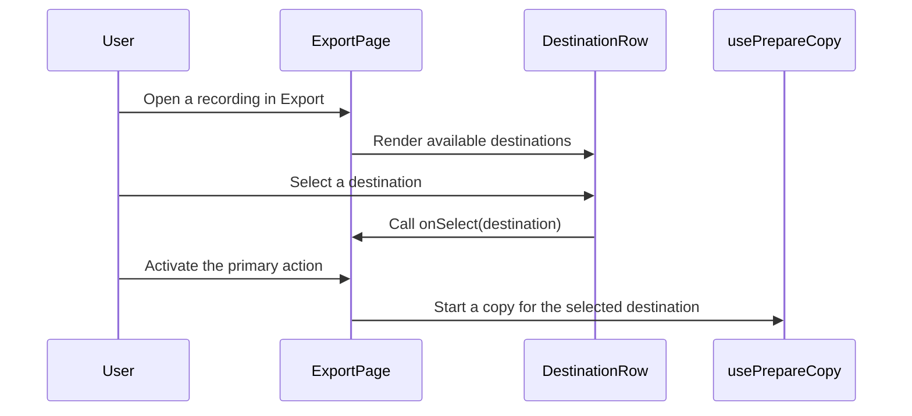

=== ISSUE_COMMENT 2026-11-01T20:57:03Z
<!-- coderabbit-ai-generated:v1 -->

<!-- This is an auto-generated comment: summarize by coderabbit.ai -->
<!-- review_stack_entry_start -->

<a href="https://app.coderabbit.ai/change-stack/niway-dev/kaipu-bench-coderabbit/pull/5?scope=ghh_OusAJGA4HG8ljoOV0wJvVx8NmnZIjc2DdjmxOu0xZWA&amp;cs_source=review_comment"><picture><source media="(prefers-color-scheme: dark)" srcset="https://storage.googleapis.com/coderabbit_public_assets/review-stack-in-coderabbit-ui-dark.svg?v=3"><source media="(prefers-color-scheme: light)" srcset="https://storage.googleapis.com/coderabbit_public_assets/review-stack-in-coderabbit-ui.svg?v=3"></picture></a>

<!-- review_stack_entry_end -->
<!-- configuration_strict_warnings_start -->

> [!NOTE]
> ### `.coderabbit.yaml` has unrecognized properties
> 
> CodeRabbit is using all valid settings from your configuration. Unrecognized properties (listed below) have been ignored and may indicate typos or deprecated fields that can be removed.
> 
> <details>
> <summary><strong><picture></picture> Parsing warnings: 1</strong></summary>
> <dl>
> <dd>
> 
> ```
> Validation error: Unrecognized key: "allow_apply_suggestions"
> ```
> 
> </dd>
> </dl>
> </details>
> 
> <details>
> <summary><strong><picture><source media="(prefers-color-scheme: dark)" srcset="https://storage.googleapis.com/coderabbit_public_assets/review-comment-icons-v1/cog-dark.svg"></picture> Configuration instructions</strong></summary>
> <dl>
> <dd>
> 
> - Please see the [configuration documentation](https://docs.coderabbit.ai/guides/configure-coderabbit) for more information.
> - You can also validate your configuration using the [online YAML validator](https://docs.coderabbit.ai/configuration/yaml-validator).
> - If your editor has YAML language server enabled, you can add the path at the top of this file to enable auto-completion and validation: `# yaml-language-server: $schema=https://coderabbit.ai/integrations/schema.v2.json`
> 
> </dd>
> </dl>
> </details>

<!-- configuration_strict_warnings_end -->
<!-- recent_review_start -->

No actionable comments were generated in the recent review.

<details>
<summary><strong><picture></picture> Recent review info</strong></summary>
<dl>
<dd>

<!-- review_info_content -->
<details>
<summary><strong><picture><source media="(prefers-color-scheme: dark)" srcset="https://storage.googleapis.com/coderabbit_public_assets/review-comment-icons-v1/cog-dark.svg"></picture> Run configuration</strong></summary>
<dl>
<dd>

- **Source mode**: Auto
- **Repository**: [niway-dev/kaipu-bench-coderabbit](<https://github.com/niway-dev/kaipu-bench-coderabbit>)
- **Branch**: [replay/pr-467/head](<https://github.com/niway-dev/kaipu-bench-coderabbit/tree/replay%2Fpr-467%2Fhead>)
- **File**: [.coderabbit.yaml](<https://github.com/niway-dev/kaipu-bench-coderabbit/blob/b12d760bd90b1e9619bab115f500f9c1a30cccf3/.coderabbit.yaml>)
- **Commit**: [b12d760](<https://github.com/niway-dev/kaipu-bench-coderabbit/commit/b12d760bd90b1e9619bab115f500f9c1a30cccf3>)
- **Layers**: Repository YAML
- **Review profile**: CHILL
- **Plan**: Advanced
- **Run ID**: `9f2d6ac8-8999-4913-a501-be00e968f824`

</dd>
</dl>
</details>

<details>
<summary><strong><picture><source media="(prefers-color-scheme: dark)" srcset="https://storage.googleapis.com/coderabbit_public_assets/review-comment-icons-v1/git-commit-horizontal-dark.svg"></picture> Commits</strong></summary>
<dl>
<dd>

Reviewing files that changed from the base of the PR and between 13b7ff5da65f3d0b59d0542132babf328ce373b3 and b12d760bd90b1e9619bab115f500f9c1a30cccf3.

</dd>
</dl>
</details>

<details>
<summary><strong><picture><source media="(prefers-color-scheme: dark)" srcset="https://storage.googleapis.com/coderabbit_public_assets/review-comment-icons-v1/file-minus-corner-dark.svg"></picture> Files ignored due to path filters: 2</strong></summary>
<dl>
<dd>

* `apps/documentation/src/content/docs/backlog/export-screen.md` is excluded by `!**/*.md` and included by `**/*`
* `apps/documentation/src/content/docs/backlog/index.mdx` is excluded by `!**/*.mdx` and included by `**/*`

</dd>
</dl>
</details>

<details>
<summary><strong><picture><source media="(prefers-color-scheme: dark)" srcset="https://storage.googleapis.com/coderabbit_public_assets/review-comment-icons-v1/file-plus-corner-dark.svg"></picture> Files selected for processing: 45</strong></summary>
<dl>
<dd>

* `apps/documentation/astro.config.mjs`
* `apps/kaipu-record/src/renderer/src/app/router.tsx`
* `apps/kaipu-record/src/renderer/src/features/library/components/import-drop-zone.module.css`
* `apps/kaipu-record/src/renderer/src/features/library/components/import-drop-zone.test.tsx`
* `apps/kaipu-record/src/renderer/src/features/library/components/import-drop-zone.tsx`
* `apps/kaipu-record/src/renderer/src/features/library/hooks/use-file-drop.test.tsx`
* `apps/kaipu-record/src/renderer/src/features/prepare/components/destination-logo.module.css`
* `apps/kaipu-record/src/renderer/src/features/prepare/components/destination-logo.tsx`
* `apps/kaipu-record/src/renderer/src/features/prepare/destination-copy.ts`
* `apps/kaipu-record/src/renderer/src/features/prepare/destinations.test.ts`
* `apps/kaipu-record/src/renderer/src/features/prepare/destinations.ts`
* `apps/kaipu-record/src/renderer/src/features/prepare/prepare-path.ts`
* `apps/kaipu-record/src/renderer/src/features/prepare/use-prepare-copy.ts`
* `apps/kaipu-record/src/renderer/src/pages/export/destination-row.module.css`
* `apps/kaipu-record/src/renderer/src/pages/export/destination-row.tsx`
* `apps/kaipu-record/src/renderer/src/pages/export/export-copy.ts`
* `apps/kaipu-record/src/renderer/src/pages/export/export-drop-zone.module.css`
* `apps/kaipu-record/src/renderer/src/pages/export/export-drop-zone.tsx`
* `apps/kaipu-record/src/renderer/src/pages/export/export-header.module.css`
* `apps/kaipu-record/src/renderer/src/pages/export/export-header.tsx`
* `apps/kaipu-record/src/renderer/src/pages/export/export-page.module.css`
* `apps/kaipu-record/src/renderer/src/pages/export/export-page.test.tsx`
* `apps/kaipu-record/src/renderer/src/pages/export/export-page.tsx`
* `apps/kaipu-record/src/renderer/src/pages/export/export-stage.module.css`
* `apps/kaipu-record/src/renderer/src/pages/export/export-stage.tsx`
* `apps/kaipu-record/src/renderer/src/pages/export/recent-exports.module.css`
* `apps/kaipu-record/src/renderer/src/pages/export/recent-exports.tsx`
* `apps/kaipu-record/src/renderer/src/pages/export/video-picker.module.css`
* `apps/kaipu-record/src/renderer/src/pages/export/video-picker.tsx`
* `apps/kaipu-record/src/renderer/src/pages/library-detail/library-detail-page.test.tsx`
* `apps/kaipu-record/src/renderer/src/pages/library/library-page.module.css`
* `apps/kaipu-record/src/renderer/src/pages/library/library-page.test.tsx`
* `apps/kaipu-record/src/renderer/src/pages/library/library-page.tsx`
* `apps/kaipu-record/src/renderer/src/pages/prepare/destination-detail.tsx`
* `apps/kaipu-record/src/renderer/src/pages/prepare/destination-list.module.css`
* `apps/kaipu-record/src/renderer/src/pages/prepare/destination-list.tsx`
* `apps/kaipu-record/src/renderer/src/pages/prepare/prepare-drop-zone.tsx`
* `apps/kaipu-record/src/renderer/src/pages/prepare/prepare-page.test.tsx`
* `apps/kaipu-record/src/renderer/src/pages/prepare/prepare-page.tsx`
* `apps/kaipu-record/src/renderer/src/shell/sidebar.test.tsx`
* `apps/kaipu-record/src/renderer/src/shell/sidebar.tsx`
* `apps/kaipu-record/src/shared/routes.ts`
* `apps/kaipu-record/src/shared/window-size.test.ts`
* `packages/i18n/messages/en.json`
* `packages/i18n/messages/es.json`

</dd>
</dl>
</details>

<details>
<summary><strong><picture><source media="(prefers-color-scheme: dark)" srcset="https://storage.googleapis.com/coderabbit_public_assets/review-comment-icons-v1/file-no-changes-dark.svg"></picture> Files with no reviewable changes: 10</strong></summary>
<dl>
<dd>

* apps/kaipu-record/src/renderer/src/pages/prepare/destination-list.module.css
* apps/kaipu-record/src/renderer/src/features/library/components/import-drop-zone.test.tsx
* apps/kaipu-record/src/renderer/src/pages/library/library-page.module.css
* apps/kaipu-record/src/renderer/src/features/library/components/import-drop-zone.tsx
* apps/kaipu-record/src/renderer/src/pages/prepare/prepare-page.test.tsx
* apps/kaipu-record/src/renderer/src/pages/prepare/destination-detail.tsx
* apps/kaipu-record/src/renderer/src/features/library/components/import-drop-zone.module.css
* apps/kaipu-record/src/renderer/src/pages/prepare/destination-list.tsx
* apps/kaipu-record/src/renderer/src/pages/prepare/prepare-page.tsx
* apps/kaipu-record/src/renderer/src/pages/prepare/prepare-drop-zone.tsx

</dd>
</dl>
</details>

**Included review availability:** This review used your included allowance. Your plan provides up to 10 included reviews per hour; 5 remain after this review.

</dd>
</dl>
</details>


<!-- recent_review_end -->
<!-- walkthrough_start -->

<details>
<summary><strong>Walkthrough</strong></summary>
<dl>
<dd>

The PR adds an Export screen for choosing videos and destinations, planning and starting exports, and viewing recent export activity. It moves import entry points from Library to Export, adds Email as a destination, and redirects legacy Prepare routes to Export.

**Changes: Export screen**

|Layer / File(s)|Summary|
|:---|:---|
|**Destination contracts and Email support** <br> `apps/kaipu-record/src/renderer/src/features/prepare/*`, `apps/kaipu-record/src/renderer/src/pages/export/export-copy.ts`|Email is added as a destination in the `keep-light` group and uses the balanced preset also used by chat. Export destination names, group messages, and display order are defined.|
|**Destination selection and export actions** <br> `apps/kaipu-record/src/renderer/src/pages/export/destination-row.*`, `apps/kaipu-record/src/renderer/src/pages/export/export-{header,stage,page}.*`, `apps/kaipu-record/src/renderer/src/features/prepare/use-prepare-copy.ts`, `apps/kaipu-record/src/renderer/src/pages/prepare/*`|The Export screen displays video details and destination options, plans copies, and offers size and framing controls. Its primary action opens an existing matching copy or starts an export. The copy hook accepts an optional destination. The former Prepare detail and destination-list components are removed.|
|**Video selection, import, and recent exports** <br> `apps/kaipu-record/src/renderer/src/pages/export/{export-drop-zone,recent-exports,video-picker}.*`, `apps/kaipu-record/src/renderer/src/pages/export/export-page.*`, `apps/kaipu-record/src/renderer/src/features/library/*`, `apps/kaipu-record/src/renderer/src/pages/library/*`|Export adds a picker for preparable master videos, file browsing and drag-and-drop entry points, and recent-export status. Library’s import and prepare-video controls are removed. Tests cover the import and selection flows, including `useFileDrop`.|
|**Routes, sidebar, and translated labels** <br> `apps/kaipu-record/src/renderer/src/app/router.tsx`, `apps/kaipu-record/src/renderer/src/features/prepare/prepare-path.ts`, `apps/kaipu-record/src/renderer/src/pages/library-detail/*`, `apps/kaipu-record/src/renderer/src/shell/*`, `apps/kaipu-record/src/shared/*`, `packages/i18n/messages/*`, `apps/documentation/astro.config.mjs`|Export routes render the new page, while legacy Prepare routes redirect and retain the query. The sidebar adds Export and tracks export activity and unseen copies. Navigation tests, route descriptions, English and Spanish messages, and the documentation sidebar are updated.|

<!-- change_assessment_start -->
**Estimated code review effort:** 4 (Complex) | ~60 minutes

<!-- change_assessment_commit:"b12d760bd90b1e9619bab115f500f9c1a30cccf3" -->
<!-- change_assessment_priority:{"version":1,"urgency":"p2","manual":false} -->
**Change:** Feature
<!-- change_assessment_end -->

### Sequence Diagram(s)



</dd>
</dl>
</details>

<!-- walkthrough_end -->
<details>
<summary><strong>Merge Risk:</strong> <strong><picture></picture> Minimal</strong> · up to <code>b12d7</code></summary>
<dl>
<dd>

<!-- final_review_risk_start -->
<!-- final_review_risk_label
**Merge Risk:** **⚪ Minimal** · up to `b12d7`
-->
<!-- final_review_risk_coverage:{"sourceCommitId":"b12d760bd90b1e9619bab115f500f9c1a30cccf3","coveredCommitId":"b12d760bd90b1e9619bab115f500f9c1a30cccf3","kind":"reviewed"} -->

No confirmed issue remains that prevents merging after normal checks.
<!-- final_review_risk_end -->

</dd>
</dl>
</details>

<details>
<summary><strong>Security architecture risk:</strong> <strong><picture></picture> Moderate</strong> · up to <code>b12d7</code></summary>
<dl>
<dd>

<!-- architecture_review_start -->
<!-- architecture_review_label
### Security Architecture Review

**Security architecture risk:** **🟡 Moderate** · up to `b12d7`
-->

The route migration and export pipeline preserve their existing controls, but removing Library’s file-drop handler creates a potential path for a dropped malicious HTML file to inherit desktop application privileges. Exploitation requires user interaction, and the demonstrated authority is limited to the affected desktop user’s library.

**Retained concerns**
- **High · security · inferred:** Removing Library’s import hook also removes its default file-drop navigation prevention. A user dropping an attacker-supplied HTML document on Library can consequently navigate the privileged main window away from the application. The replacement document would receive the existing preload bridge and could enumerate and delete local library items through handlers that do not validate document origin. This worsens exposure on Library even though the underlying bridge and navigation configuration are unchanged.

<details>
<summary><strong>Security review details</strong></summary>
<dl>
<dd>

**Security Blast Radius**
- _inferred_ — The identified attack requires an attacker-controlled local HTML file and a user dropping it on Library. If default navigation occurs, the exposed listing and deletion APIs permit destructive operations across the current desktop vault, including media and associated metadata. The inspected evidence does not establish cross-tenant, server-side, or arbitrary host-code execution.

**Security Findings and Attack Paths**
- _inferred_ — The security regression is loss of navigation prevention, not weaker video validation: Library previously canceled every OS file drop before import filtering could reject non-video files. After removal, a dropped HTML document can take the browser-navigation path instead of entering the validated import pipeline. The resulting document would inherit the unchanged preload bridge.

**Trust Boundaries and Controls**
- _observed_ — The main window denies new windows but its creation block does not block same-window navigation. The preload exposes its bridge without checking document origin, and library listing and deletion handlers do not validate the caller’s frame or URL. The application’s CSP is declared in its own HTML document, while context isolation explicitly permits these bridge methods in the document’s main world.

**Resilience and Maintainability Implications**
- _inferred_ — File-drop navigation protection currently shares the lifecycle of an optional intake feature. Export still mounts that protection, but removing intake from Library also removes the control there. This couples a desktop trust boundary to page-level product behavior and makes future intake moves security-sensitive.

**Hardening Proposals**
- _proposed_ — Separate global navigation prevention from page-specific file importing. Enforce the trusted application document boundary in the main process, with document-origin validation for privileged IPC as defense in depth.

</dd>
</dl>
</details>
<!-- architecture_review_end -->

</dd>
</dl>
</details>
<!-- pre_merge_checks_walkthrough_start -->

<details>
<summary><strong>Pre-merge checks: <sup><picture></picture></sup> 5</strong></summary>
<dl>
<dd>

|         Check name         |                                             Status                                             | Explanation                                                                                                                                                                                               |
| :------------------------ | :--------------------------------------------------------------------------------------------: | :-------------------------------------------------------------------------------------------------------------------------------------------------------------------------------------------------------- |
|      Description Check     |  | Check skipped - CodeRabbit’s high-level summary is enabled.                                                                                                                                               |
|         Title check        |  | The title clearly and concisely describes the main change: replacing Prepare with an Export screen and adding a dedicated rail entry.                                                                     |
|     Docstring Coverage     |  | Docstring coverage is 90.00% which is sufficient. The required threshold is 80.00%. Docstring coverage is scoped to functions touched by this diff with cyclomatic complexity of at least 2. Documentati… |
|     Linked Issues check    |  | Check skipped because no linked issues were found for this pull request.                                                                                                                                  |
| Out of Scope Changes check |  | Check skipped because no linked issues were found for this pull request.                                                                                                                                  |

<details>
<summary><strong>Full details: Docstring Coverage</strong></summary>
<dl>
<dd>

**Explanation**

Docstring coverage is 90.00% which is sufficient. The required threshold is 80.00%. Docstring coverage is scoped to functions touched by this diff with cyclomatic complexity of at least 2. Documentation-only edits and deletions within surviving functions are included; unchanged diff context and fully deleted functions are excluded. Analyzed 20 functions across 25 files. (10 skipped: 10 unsupported.)

</dd>
</dl>
</details>

</dd>
</dl>
</details>

<!-- pre_merge_checks_walkthrough_end -->
<!-- finishing_touch_checkbox_start -->

<details>
<summary><strong>Finishing Touches</strong></summary>
<dl>
<dd>

<details open>
<summary><strong>Generate docstrings</strong></summary>
<dl>
<dd>

- [ ] <!-- {"checkboxId":"3e1879ae-f29b-4d0d-8e06-d12b7ba33d98"} --> Commit to this branch
- [ ] <!-- {"checkboxId":"7962f53c-55bc-4827-bfbf-6a18da830691"} --> Create a new PR

</dd>
</dl>
</details>
<details open>
<summary><strong>Generate unit tests (beta)</strong></summary>
<dl>
<dd>

- [ ] <!-- {"checkboxId": "6ba7b810-9dad-11d1-80b4-00c04fd430c8", "radioGroupId": "utg-output-choice-group-6563903139"} --> Commit to this branch
- [ ] <!-- {"checkboxId": "f47ac10b-58cc-4372-a567-0e02b2c3d479", "radioGroupId": "utg-output-choice-group-6563903139"} --> Create a new PR

</dd>
</dl>
</details>

</dd>
</dl>
</details>

<!-- finishing_touch_checkbox_end -->

<!-- autopilot:start -->
- [ ] <!-- {"checkboxId":"2708ad07-9f24-4260-9c11-7dc76a49f2e3"} --> <strong title="Keep fixing CodeRabbit findings and required CI, and resolving merge conflicts">Autofix</strong> · Keep fixing CodeRabbit findings and required CI, and resolving merge conflicts
<!-- autopilot:end -->

=== ISSUE_COMMENT 2026-11-01T21:08:15Z
<!-- coderabbit-ai-generated:v1 -->

<!-- This is an auto-generated reply by CodeRabbit -->
<!-- CodeRabbit review command invocation: v2:af26abd100126713b1bf122bfb2771fbf5d22269da5f7b5a398792dc2ba9c11c -->
<details>
<summary>Action performed</summary>
<dl>
<dd>

Review finished.

> Note: CodeRabbit is an incremental review system and does not re-review already reviewed commits. This command is applicable only when automatic reviews are paused.

</dd>
</dl>
</details>

