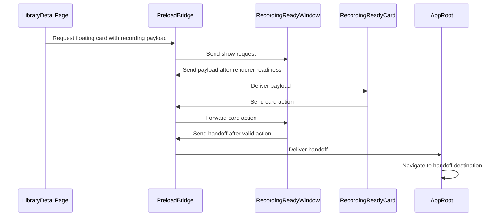

## issue comment by coderabbitai[bot] at 2026-11-01T23:32:43Z

<!-- coderabbit-ai-generated:v1 -->

<!-- This is an auto-generated comment: summarize by coderabbit.ai -->
<!-- review_stack_entry_start -->

<a href="https://app.coderabbit.ai/change-stack/niway-dev/kaipu-bench-coderabbit-v2/pull/5?scope=ghh_OusAJGA4HG8ljoOV0wJvVx8NmnZIjc2DdjmxOu0xZWA&amp;cs_source=review_comment"><picture><source media="(prefers-color-scheme: dark)" srcset="https://storage.googleapis.com/coderabbit_public_assets/review-stack-in-coderabbit-ui-dark.svg?v=3"><source media="(prefers-color-scheme: light)" srcset="https://storage.googleapis.com/coderabbit_public_assets/review-stack-in-coderabbit-ui.svg?v=3"></picture></a>

<!-- review_stack_entry_end -->
<!-- configuration_strict_warnings_start -->

> [!NOTE]
> ### `.coderabbit.yaml` has unrecognized properties
> 
> CodeRabbit is using all valid settings from your configuration. Unrecognized properties (listed below) have been ignored and may indicate typos or deprecated fields that can be removed.
> 
> <details>
> <summary><strong><picture></picture> Parsing warnings: 1</strong></summary>
> <dl>
> <dd>
> 
> ```
> Validation error: Unrecognized key: "allow_apply_suggestions"
> ```
> 
> </dd>
> </dl>
> </details>
> 
> <details>
> <summary><strong><picture><source media="(prefers-color-scheme: dark)" srcset="https://storage.googleapis.com/coderabbit_public_assets/review-comment-icons-v1/cog-dark.svg"></picture> Configuration instructions</strong></summary>
> <dl>
> <dd>
> 
> - Please see the [configuration documentation](https://docs.coderabbit.ai/guides/configure-coderabbit) for more information.
> - You can also validate your configuration using the [online YAML validator](https://docs.coderabbit.ai/configuration/yaml-validator).
> - If your editor has YAML language server enabled, you can add the path at the top of this file to enable auto-completion and validation: `# yaml-language-server: $schema=https://coderabbit.ai/integrations/schema.v2.json`
> 
> </dd>
> </dl>
> </details>

<!-- configuration_strict_warnings_end -->
<!-- recent_review_start -->

No actionable comments were generated in the recent review.

<details>
<summary><strong><picture></picture> Recent review info</strong></summary>
<dl>
<dd>

<!-- review_info_content -->
<details>
<summary><strong><picture><source media="(prefers-color-scheme: dark)" srcset="https://storage.googleapis.com/coderabbit_public_assets/review-comment-icons-v1/cog-dark.svg"></picture> Run configuration</strong></summary>
<dl>
<dd>

- **Source mode**: Auto
- **Repository**: [niway-dev/kaipu-bench-coderabbit-v2](<https://github.com/niway-dev/kaipu-bench-coderabbit-v2>)
- **Branch**: [replay/pr-466/head](<https://github.com/niway-dev/kaipu-bench-coderabbit-v2/tree/replay%2Fpr-466%2Fhead>)
- **File**: [.coderabbit.yaml](<https://github.com/niway-dev/kaipu-bench-coderabbit-v2/blob/b2705a9ce2593b29ae50235312a4226955bbbb36/.coderabbit.yaml>)
- **Commit**: [b2705a9](<https://github.com/niway-dev/kaipu-bench-coderabbit-v2/commit/b2705a9ce2593b29ae50235312a4226955bbbb36>)
- **Layers**: Repository YAML
- **Review profile**: CHILL
- **Plan**: Advanced
- **Run ID**: `fc443791-e3a4-48a5-9e46-596c1d1d5bd9`

</dd>
</dl>
</details>

<details>
<summary><strong><picture><source media="(prefers-color-scheme: dark)" srcset="https://storage.googleapis.com/coderabbit_public_assets/review-comment-icons-v1/git-commit-horizontal-dark.svg"></picture> Commits</strong></summary>
<dl>
<dd>

Reviewing files that changed from the base of the PR and between 13b7ff5da65f3d0b59d0542132babf328ce373b3 and b2705a9ce2593b29ae50235312a4226955bbbb36.

</dd>
</dl>
</details>

<details>
<summary><strong><picture><source media="(prefers-color-scheme: dark)" srcset="https://storage.googleapis.com/coderabbit_public_assets/review-comment-icons-v1/file-minus-corner-dark.svg"></picture> Files ignored due to path filters: 2</strong></summary>
<dl>
<dd>

* `apps/documentation/src/content/docs/backlog/floating-ready-window.md` is excluded by `!**/*.md` and included by `**/*`
* `apps/documentation/src/content/docs/backlog/index.mdx` is excluded by `!**/*.mdx` and included by `**/*`

</dd>
</dl>
</details>

<details>
<summary><strong><picture><source media="(prefers-color-scheme: dark)" srcset="https://storage.googleapis.com/coderabbit_public_assets/review-comment-icons-v1/file-plus-corner-dark.svg"></picture> Files selected for processing: 26</strong></summary>
<dl>
<dd>

* `apps/documentation/astro.config.mjs`
* `apps/kaipu-record/src/main/index.ts`
* `apps/kaipu-record/src/main/recording/recording-hub.test.ts`
* `apps/kaipu-record/src/main/recording/recording-hub.ts`
* `apps/kaipu-record/src/main/recording/recording-ready-window.test.ts`
* `apps/kaipu-record/src/main/recording/recording-ready-window.ts`
* `apps/kaipu-record/src/preload/index.ts`
* `apps/kaipu-record/src/renderer/src/assets/main.css`
* `apps/kaipu-record/src/renderer/src/features/recording-ready/recording-ready-card.module.css`
* `apps/kaipu-record/src/renderer/src/features/recording-ready/recording-ready-card.test.tsx`
* `apps/kaipu-record/src/renderer/src/features/recording-ready/recording-ready-card.tsx`
* `apps/kaipu-record/src/renderer/src/features/recording-ready/use-floating-ready-card.ts`
* `apps/kaipu-record/src/renderer/src/features/recording-ready/use-recording-ready-hand-offs.test.ts`
* `apps/kaipu-record/src/renderer/src/features/recording-ready/use-recording-ready-hand-offs.ts`
* `apps/kaipu-record/src/renderer/src/features/status-cards/post-recording-card.tsx`
* `apps/kaipu-record/src/renderer/src/main.tsx`
* `apps/kaipu-record/src/renderer/src/pages/library-detail/library-detail-page.test.tsx`
* `apps/kaipu-record/src/renderer/src/pages/library-detail/library-detail-page.tsx`
* `apps/kaipu-record/src/renderer/src/shell/app-root.tsx`
* `apps/kaipu-record/src/renderer/src/test/setup.ts`
* `apps/kaipu-record/src/shared/types/electron-api.ts`
* `apps/kaipu-record/src/shared/types/ipc.ts`
* `apps/kaipu-record/src/shared/types/recording-ready.test.ts`
* `apps/kaipu-record/src/shared/types/recording-ready.ts`
* `packages/i18n/messages/en.json`
* `packages/i18n/messages/es.json`

</dd>
</dl>
</details>

**Included review availability:** This review used your included allowance. Your plan provides up to 10 included reviews per hour; 6 remain after this review.

</dd>
</dl>
</details>


<!-- recent_review_end -->
<!-- walkthrough_start -->

<details>
<summary><strong>Walkthrough</strong></summary>
<dl>
<dd>

Adds a floating recording-ready card that uses the latest take’s display when available. The card receives recording details through IPC and reports user actions. The recording page falls back to an in-app card when the floating window cannot open.

**Changes: Recording-Ready Card**

|Layer / File(s)|Summary|
|:---|:---|
|**Recording-ready contracts and bridge** <br> `apps/kaipu-record/src/shared/types/recording-ready.ts`, `apps/kaipu-record/src/shared/types/recording-ready.test.ts`, `apps/kaipu-record/src/shared/types/electron-api.ts`, `apps/kaipu-record/src/shared/types/ipc.ts`, `apps/kaipu-record/src/preload/index.ts`|Defines and validates the payload, actions, and handoffs. Adds IPC channels and preload methods for showing the card, receiving payloads, and sending readiness, resize, action, and handoff messages.|
|**Display-aware window lifecycle** <br> `apps/kaipu-record/src/main/recording/recording-hub.ts`, `apps/kaipu-record/src/main/recording/recording-hub.test.ts`, `apps/kaipu-record/src/main/recording/recording-ready-window.ts`, `apps/kaipu-record/src/main/recording/recording-ready-window.test.ts`, `apps/kaipu-record/src/main/index.ts`|Tracks the latest take’s display and adds a floating window with display selection, bounded positioning, renderer-validated IPC, action handling, and shutdown cleanup.|
|**Floating card rendering and actions** <br> `apps/kaipu-record/src/renderer/src/main.tsx`, `apps/kaipu-record/src/renderer/src/features/recording-ready/*`, `apps/kaipu-record/src/renderer/src/features/status-cards/post-recording-card.tsx`, `apps/kaipu-record/src/renderer/src/assets/main.css`, `packages/i18n/messages/{en,es}.json`|Adds the recording-ready render target and card. Reports card size and actions, updates the shared post-recording card for floating-window use, and adds related styles and translations.|
|**Recording-page requests and handoffs** <br> `apps/kaipu-record/src/renderer/src/pages/library-detail/library-detail-page.tsx`, `apps/kaipu-record/src/renderer/src/pages/library-detail/library-detail-page.test.tsx`, `apps/kaipu-record/src/renderer/src/features/recording-ready/use-floating-ready-card.ts`, `apps/kaipu-record/src/renderer/src/features/recording-ready/use-recording-ready-hand-offs.ts`, `apps/kaipu-record/src/renderer/src/features/recording-ready/use-recording-ready-hand-offs.test.ts`, `apps/kaipu-record/src/renderer/src/shell/app-root.tsx`, `apps/kaipu-record/src/renderer/src/test/setup.ts`, `apps/documentation/astro.config.mjs`|Requests the floating card with recording metadata when eligible and shows the in-app card when the request fails. Routes handoffs to Prepare, the editor, or recording detail, and adds the feature to the documentation Backlog sidebar.|

<!-- change_assessment_start -->
**Estimated code review effort:** 4 (Complex) | ~60 minutes

<!-- change_assessment_commit:"b2705a9ce2593b29ae50235312a4226955bbbb36" -->
<!-- change_assessment_priority:{"version":1,"urgency":"p2","manual":false} -->
**Change:** Feature
<!-- change_assessment_end -->

### Sequence Diagram(s)



</dd>
</dl>
</details>

<!-- walkthrough_end -->
<details>
<summary><strong>Merge Risk:</strong> <strong><picture></picture> Minimal</strong> · up to <code>b2705</code></summary>
<dl>
<dd>

<!-- final_review_risk_start -->
<!-- final_review_risk_label
**Merge Risk:** **⚪ Minimal** · up to `b2705`
-->
<!-- final_review_risk_coverage:{"sourceCommitId":"b2705a9ce2593b29ae50235312a4226955bbbb36","coveredCommitId":"b2705a9ce2593b29ae50235312a4226955bbbb36","kind":"reviewed"} -->

No concrete issue currently prevents merging after normal checks.
<!-- final_review_risk_end -->

</dd>
</dl>
</details>

<details>
<summary><strong>Security architecture risk:</strong> <strong><picture></picture> Low</strong> · up to <code>b2705</code></summary>
<dl>
<dd>

<!-- architecture_review_start -->
<!-- architecture_review_label
### Security Architecture Review

**Security architecture risk:** **🔵 Low** · up to `b2705`
-->

The change mainly affects local desktop presentation and navigation. Actions are restricted to known choices, and downstream pages still resolve recordings through the library. A replacement race can associate a click with a different recording, while some caller-trust and failure-recovery behavior remains unverified. No automatic publication or new remote-access path was established.

**Retained concerns**
- **Low · reliability · inferred:** Actions are authenticated to the reusable window, but not to the recording displayed when the user pressed the button. If recording B replaces A before A's queued action reaches main, act() consumes B's current payload, hides B, and can open B in Prepare, the editor, or detail. The base used page-local callbacks bound to its recording; the new asynchronous handoff loses that binding. This is a bounded action-ownership race, not evidence of automatic sharing or unauthorized library access.

<details>
<summary><strong>Security review details</strong></summary>
<dl>
<dd>

**Security Blast Radius**
- _inferred_ — The demonstrated new outcomes affect presentation and asset selection in one running desktop application. A compromised shared-preload renderer already had broad library capabilities at the base, including deletion. The new show endpoint adds floating-card control, but the inspected evidence does not establish a new cross-account or operating-system privilege escalation.

**Security Findings and Attack Paths**
- _observed_ — The inspected action path performs local navigation, not direct publication. Prepare resolves the supplied ID through the library and starts copy creation through a subsequent primary action. The editor independently resolves the library item and derives an eligible source, so caller-supplied canEdit does not alone grant editor access.

**Trust Boundaries and Controls**
- _observed_ — Ready, resize, and action events require the live floating window's WebContents. The show invoke handler instead ignores its event sender and accepts structurally valid caller-provided asset metadata. No frame or origin check is present in that handler. Packaged local content and downstream library resolution are counterevidence to an exploitable authority bypass, not substitutes for caller authentication.

**Resilience and Maintainability Implications**
- _observed_ — The fallback acknowledges window creation rather than successful renderer presentation. show() can return true before readiness, and production loading is fire-and-forget. Consequently, a later renderer-load failure is outside the implemented fallback path. This limits notification recovery; it does not establish loss of the saved recording.

**Hardening Proposals**
- _proposed_ — Bind card actions to a main-issued presentation generation and asset identity, rejecting events from replaced presentations. Separately, restrict show requests to the intended trusted main-window frame and consider a card-specific preload capability set. These are contract and least-privilege proposals, not evidence of an established external attack path.

</dd>
</dl>
</details>
<!-- architecture_review_end -->

</dd>
</dl>
</details>
<!-- pre_merge_checks_walkthrough_start -->

<details>
<summary><strong>Pre-merge checks: <sup><picture></picture></sup> 4 · <sup><picture></picture></sup> 1</strong></summary>
<dl>
<dd>

<strong><sup><picture></picture></sup> Failed checks: 1 warning</strong>

|     Check name     |                                              Status                                              | Explanation                                                                                                                                                                                               | Resolution                                                                         |
| :---------------- | :----------------------------------------------------------------------------------------------: | :-------------------------------------------------------------------------------------------------------------------------------------------------------------------------------------------------------- | :--------------------------------------------------------------------------------- |
| Docstring Coverage |  | Docstring coverage is 75.00% which is insufficient. The required threshold is 80.00%. Docstring coverage is scoped to functions touched by this diff with cyclomatic complexity of at least 2. Documenta… | Write docstrings for the functions missing them to satisfy the coverage threshold. |

<details>
<summary><strong><sup><picture></picture></sup> Passed checks: 4 passed</strong></summary>
<dl>
<dd>

|         Check name         |                                             Status                                             | Explanation                                                                                                                        |
| :------------------------ | :--------------------------------------------------------------------------------------------: | :--------------------------------------------------------------------------------------------------------------------------------- |
|      Description Check     |  | Check skipped - CodeRabbit’s high-level summary is enabled.                                                                        |
|         Title check        |  | The title clearly identifies the main change: moving the “Your video is ready” card into a floating window outside the app window. |
|     Linked Issues check    |  | Check skipped because no linked issues were found for this pull request.                                                           |
| Out of Scope Changes check |  | Check skipped because no linked issues were found for this pull request.                                                           |

</dd>
</dl>
</details>

<details>
<summary><strong>Full details: Docstring Coverage</strong></summary>
<dl>
<dd>

**Explanation**

Docstring coverage is 75.00% which is insufficient. The required threshold is 80.00%. Docstring coverage is scoped to functions touched by this diff with cyclomatic complexity of at least 2. Documentation-only edits and deletions within surviving functions are included; unchanged diff context and fully deleted functions are excluded. Analyzed 12 functions across 22 files. (4 skipped: 4 unsupported.)

**Resolution**

Write docstrings for the functions missing them to satisfy the coverage threshold.

</dd>
</dl>
</details>

</dd>
</dl>
</details>

<!-- pre_merge_checks_walkthrough_end -->
<!-- finishing_touch_checkbox_start -->

<details>
<summary><strong>Finishing Touches</strong></summary>
<dl>
<dd>

<details open>
<summary><strong>Generate docstrings</strong></summary>
<dl>
<dd>

- [ ] <!-- {"checkboxId":"3e1879ae-f29b-4d0d-8e06-d12b7ba33d98"} --> Commit to this branch
- [ ] <!-- {"checkboxId":"7962f53c-55bc-4827-bfbf-6a18da830691"} --> Create a new PR

</dd>
</dl>
</details>
<details open>
<summary><strong>Generate unit tests (beta)</strong></summary>
<dl>
<dd>

- [ ] <!-- {"checkboxId": "6ba7b810-9dad-11d1-80b4-00c04fd430c8", "radioGroupId": "utg-output-choice-group-6565554970"} --> Commit to this branch
- [ ] <!-- {"checkboxId": "f47ac10b-58cc-4372-a567-0e02b2c3d479", "radioGroupId": "utg-output-choice-group-6565554970"} --> Create a new PR

</dd>
</dl>
</details>

</dd>
</dl>
</details>

<!-- finishing_touch_checkbox_end -->

<!-- autopilot:start -->
- [ ] <!-- {"checkboxId":"2708ad07-9f24-4260-9c11-7dc76a49f2e3"} --> <strong title="Keep fixing CodeRabbit findings and required CI, and resolving merge conflicts">Autofix</strong> · Keep fixing CodeRabbit findings and required CI, and resolving merge conflicts
<!-- autopilot:end -->

## issue comment by coderabbitai[bot] at 2026-11-01T23:33:45Z

<!-- coderabbit-ai-generated:v1 -->

<!-- This is an auto-generated reply by CodeRabbit -->
<!-- CodeRabbit review command invocation: v2:a593037ba9cd62f064c8d4be537fe7a5a6db66e91a57f4ba1f923678482845d9 -->
<details>
<summary>Action performed</summary>
<dl>
<dd>

Review finished.

> Note: CodeRabbit is an incremental review system and does not re-review already reviewed commits. This command is applicable only when automatic reviews are paused.

</dd>
</dl>
</details>

